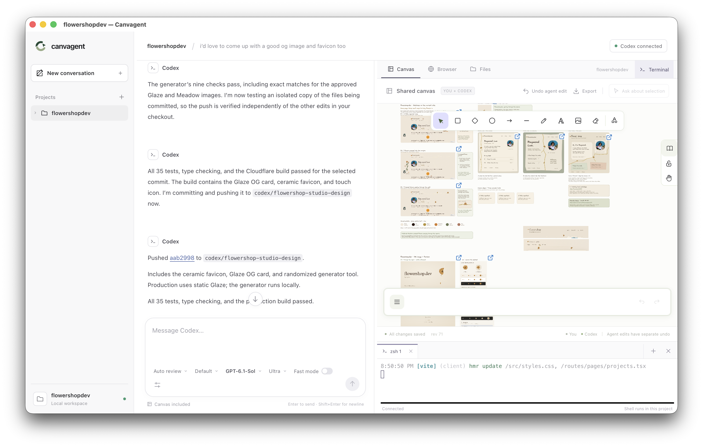

<picture>
  <source media="(prefers-color-scheme: dark)" srcset="public/brand/mark-dark.svg">
  
</picture>

# canvagent

Canvagent is a local agent workspace with a persistent Excalidraw canvas shared by you and your agent. Bring Codex, Claude Code, OpenCode, another ACP harness, or a model API. Chat about a project, sketch an idea, drop in a screenshot, and let your agent inspect and annotate the same board while it works.



*Plan, build, and review with your preferred agent beside a canvas you can both edit.*

**Status:** the local application is implemented. Codex CLI **0.159.2** accepted live initialization, thread creation, and turn submission; expired login credentials prevented inference. [Runtime evidence and remaining checks](docs/implementation.md#runtime-status) distinguish verified protocol behavior from model-driven canvas behavior still to verify.

## Run locally

Use **Node.js 24 or newer**. For the default agent, install [Codex CLI](https://developers.openai.com/codex/cli/) on your `PATH`. Sign in through Codex's normal login flow:

```sh
codex login
npm ci
npm run build
npm start -- --workspace /absolute/path/to/your/project
```

Open **http://127.0.0.1:4317**. Choose an agent beside the message composer. The initial default is Codex, which connects automatically using your existing login and available models. If authentication needs renewal, run `codex login` and use **Retry** beside the composer. Connecting does not start or replay a task. Keep the browser open when asking the agent to inspect drawings or screenshots: canvas captures render in that browser.

To choose the saved-data directory or local port:

```sh
npm start -- --workspace /absolute/path/to/project --data-dir /absolute/path/to/saved-data --port 4317
```

Run these commands from the Canvagent checkout. The workspace defaults to the current directory when omitted. The service listens on `127.0.0.1`.

## Bring your own agent

Choose **Codex**, **Claude Code**, **OpenCode**, or **Gemini CLI** in the composer. **Manage agents** lets you configure installed ACP harnesses, add a custom executable and argument array, or connect an **OpenAI compatible API** or **Anthropic API** using a model ID and API key. Authenticate through your harness before selecting it. Agent choice belongs to each conversation; switching agents after a conversation has history starts a new conversation and preserves the original session.

Pasted API keys stay in server memory until restart; environment-variable references provide reusable credentials. Direct API agents can use the canvas and workspace tools. File changes and commands require explicit approval. Harnesses keep their own tools, permissions, and authentication. See [agent setup, capabilities, and limitations](docs/agents.md).

The [Zed source review](docs/zed-research.md) covers ACP architecture and a broader feature matrix. The [roadmap](docs/roadmap.md) records what shipped and the next work on setup, worktrees, review, context, and workflows.

Chat supports **@mentions**, visible context chips, and **pasted or dropped images**, including image-only messages. Attach files or selected lines from the editor, canvas objects, conversations, and artifacts, then inspect the exact context before sending. **Review changes** in the conversation shows saved before/after file diffs and affected canvas objects, with guarded file restoration. See [context, image, and review behavior](docs/context-and-review.md).

## Desktop app (Tauri)

The desktop app opens with a native workspace folder picker and runs the same chat, Excalidraw editor, and Codex backend in a Tauri window. It bundles a standalone Node 24 runtime; installed-app users need their chosen harness and login, or model API credentials, and do not need to install Node separately.

To build or develop it, install the [Tauri platform prerequisites](https://v2.tauri.app/start/prerequisites/) and Rust 1.90 or later, then run:

```sh
npm ci
npm run desktop:dev
```

Build a macOS application bundle:

```sh
npm run desktop:build -- --bundles app
```

The result is `src-tauri/target/release/bundle/macos/Canvagent.app`, signed ad hoc for local use. Launch it and choose a project folder; Codex connects automatically. Use the **+** beside **Projects** in the sidebar or **Workspace → Open Workspace…** to add another folder. Each project has its own conversations and canvas. Click a project or one of its conversations to switch within the same window; pending canvas edits are saved first, and background Codex turns continue running. Projects stay in the sidebar across restarts, and the launcher remembers the last workspace. Closing the window saves pending edits and shuts down all projects, with confirmation if Codex is still working.

The build downloads the official Node archive and checks its SHA-256 against `scripts/node-runtime.json`. Downloaded runtimes, the optional project-local Rust toolchain, and generated desktop resources are ignored by Git. The desktop scripts detect the local toolchain under `.canvagent/toolchain` if one is installed there; otherwise they use your normal Rust installation.

Desktop data is stored in the OS application-data directory under `app.canvagent.desktop/workspaces/<workspace-hash>` (on macOS, under `~/Library/Application Support/`). An existing default CLI database under `~/.local/share/canvagent/<workspace-hash>` is reused when present. Custom browser `--data-dir` locations remain separate.

```sh
npm run desktop:check
npm run test:desktop
```

`desktop:check` builds resources and checks the Rust shell. The desktop tests use the prepared Node binary and resources to verify serving, origin checks, WebSocket delivery, persistence, parent-process shutdown, and an actual interactive terminal without model calls. After building the app, verify its final signed Node binary and packaged resources as well:

```sh
CANVAGENT_DESKTOP_BUNDLE="$PWD/src-tauri/target/release/bundle/macos/Canvagent.app" npm run test:desktop
```

An invalid or incomplete bundle path fails the tests. The macOS bundle is for local use; distribution to other Macs requires Apple signing and notarization. Windows and Linux builds need their native Tauri prerequisites and have not yet been validated.

## Use the shared canvas

- Draw or import an image, then ask Codex about it in chat. Select objects to focus the request.
- The agent can freehand draw arbitrary strokes and custom paths, with pen pressure, colour, thickness, fill, opacity and grouping. Drawings remain native editable Excalidraw elements. Revision checks protect newer edits, and the interface provides undo for agent changes.
- Committed canvas changes during a running turn send batched notices through Codex steering. Idle drawing does not start agent work. Notice delivery appears in the activity feed.
- Use ordinary chat, tool activity, approval controls, stop, conversation history, and model selection alongside the canvas.
- Ask the agent to publish generated files and attach them to the board. Raster images get previews; other outputs get download links with provenance. Workspace files are never published automatically.

Each project's board is shared across its saved conversations. The **Projects** sidebar groups conversations by folder and lets you collapse projects or switch between them. In a browser, **Add project** accepts a folder path on the computer running Canvagent; the desktop app uses a native folder picker. You can switch conversations and projects, create new conversations, and run work in parallel. Each conversation has its own Codex runtime, approvals, stop control, and live canvas notices; the sidebar shows running conversations and those awaiting approval. Unsent message drafts survive project switching and reloads in the same window. The app supports one editing browser. Visual canvas captures require that project's canvas to be open; ordinary work and board tools can continue in background projects. Codex retains its execution loop, built-in tools, sandbox, authentication, and native conversation history.

On wider windows, drag the dividers beside the sidebar and between chat and the workspace to resize them. Focus a divider to adjust it with Left/Right Arrow, Shift for larger steps, or Home/End; double-click to reset. Sizes are saved per project across app restarts.

Published outputs appear under **Files from this conversation**, collapsed by default with a file count. Click its header, or press Enter/Space when focused, to open the scrollable download list. Each conversation starts collapsed; new files preserve an already expanded list.

The right side has **Canvas**, **Browser**, **Files**, and **Changes** tabs. Changes shows the current Git branch, changed files, staged and working-tree diffs, and untracked file previews. Select a file to review its diff and use Refresh after edits. Binary files and large diffs show explicit preview limits. This panel is read-only. Browser opens website URLs and local development servers beside chat, with back, forward, reload, and an address bar. Desktop uses a native embedded browser; the regular web interface uses an iframe, so sites that prohibit embedding require the desktop app. Browser pages have no access to desktop commands.

In Browser, choose **Annotate** to draw temporary marks with a pen, highlighter, or rectangle tool and a choice of colors. Use **Undo** or **Clear** to adjust marks, and **Done** or **Escape** to resume browsing. Marks clear when a new page loads.

In Canvas, choose **Add website** to place a live localhost preview or an iframe-compatible website directly on the board. **Draw** lets ordinary editable Excalidraw strokes, arrows, and text sit over and around the page; **Browse** sends clicks, typing, and scrolling into the website. Use **Select website frame** to move or resize it with the usual canvas handles. Frames follow canvas pan and zoom, and their URLs and drawings survive reload and editable export. If you add multiple websites, choose the active frame from the website selector.

This first version keeps drawings at canvas coordinates: they do not follow page scrolling or individual buttons, and browser page state is not part of the saved board. Some sites prevent iframe embedding; use the separate Browser panel for them. Agent captures and image exports show the website frame placeholder and drawings, without the live webpage pixels. Canvas tools report that limitation and expose each frame’s URL to the agent. The live-frame navigation policy is supported in the macOS desktop app; Windows and Linux remain unverified.

Files uses [Monaco](https://github.com/microsoft/monaco-editor), the editor from VS Code, with syntax highlighting, completion for supported languages, find/replace, multi-cursor editing, folding, comments, formatting, undo/redo, and editor commands. It browses the current project folder, opens multiple files, previews images, and edits UTF-8 text up to 2 MB. Use **Save file**, **⌘S**, or **Ctrl+S** to write changes. If Codex or another editor changes a file on disk, saving reports a conflict and preserves your draft. Switching panels and files keeps open buffers and their undo history; leaving a project with unsaved files offers save, discard, or cancel. File access stays inside the project folder, including symlink targets; Git internals are excluded. Other binary files can be downloaded.

Vim key bindings are on by default through [monaco-vim](https://github.com/brijeshb42/monaco-vim). Start in Normal mode, press `i` to insert, use Escape to return to Normal, and save with `:w`. The **Vim on/off** control in the file toolbar switches to ordinary editor typing; this preference is saved separately for each project.

Use **Terminal** or **Ctrl+backtick** to open the terminal drawer beside your workspace. It runs an interactive shell in the current project through a real PTY, with terminal tabs, resizing, and scrollback. Hiding the drawer or switching projects keeps its shells running; close a terminal tab to end that session. Quitting Canvagent stops its terminal sessions.

| Shortcut | Action |
| --- | --- |
| ⌘P / Ctrl+P | Quick Open: find files by name or path. |
| ⌘F / Ctrl+F | Find and replace in the current file. |
| ⌘/ / Ctrl+/ | Toggle comments, including JSX markup in TSX/JSX files with Vim enabled. |
| ⌘⇧F / Ctrl+Shift+F | Search across project files, with case, whole-word, and regex options. |
| ⌘⇧P / Ctrl+Shift+P | Open the editor command palette. |
| Ctrl+backtick | Show or hide the terminal drawer. |

Project search results open the matching file at its line and column. Search skips generated folders such as `node_modules`, `.git`, and `dist`, and runs in a worker with bounded results. Desktop's **Go** menu provides these commands even when the embedded browser has focus. Browser navigation reports loading and connection failures and supports retrying a failed address.

The chat composer's toolbar has approval mode, Default/Plan mode, model, thinking level, and a Fast mode toggle. Toolbar choices save immediately for that conversation's next turn and are remembered as the project's defaults for new conversations, including after restarting the app. Existing conversations retain their own settings, and an active turn keeps its original settings. **More Codex settings** opens additional controls for approval policy and reviewer, sandbox access, networking and writable folders, web search, reasoning summaries, response verbosity, and extra instructions. In that dialog, **Save settings** applies only to the current conversation; **Save as defaults** changes all starting settings for new conversations. Available thinking levels and speed tiers come from Codex's model catalog, and Codex's managed requirements still apply. Additional native thread configuration can be supplied as JSON in the settings dialog; explicit controls take priority, and the shared canvas integration remains enabled. These controls do not edit your global Codex configuration.

Existing conversations receive the current canvas tools automatically when you send the next message after an app upgrade. Canvagent resumes the same native Codex thread and discovers the current tools through its authenticated local canvas connection. Your conversation context, chat history and project canvas stay in place. No new conversation or history summary is needed.

The **Notifications** bell shows completed turns, approval and input requests, and failures across all projects. Select a notification to open its conversation, or use **Mark all as read** to clear the unread count. Each project retains its latest 100 notifications and their read state after restarting. Stopping a turn does not create a completion alert.

Enable **System notifications** in the notification list to receive alerts while Canvagent is unfocused or hidden. This setting is saved across projects and restarts. Desktop uses native notifications; the browser asks for notification permission when you enable them. Clicking an alert opens its conversation. System settings and Focus modes may suppress alerts, and alerts are delivered while Canvagent is open; launching the app does not replay old alerts.

The chat interface uses [assistant-ui](https://github.com/assistant-ui/assistant-ui) for conversations, streamed messages, Markdown, and the composer. It connects to the existing local Codex backend; no Assistant Cloud account or additional model API key is needed. Excalidraw remains the shared canvas.

## Saved work

The default data location is `~/.local/share/canvagent/<workspace-hash>`, where the hash identifies the absolute workspace path. Startup prints the exact directory. It contains the SQLite database, imported image bytes, and published artifact bytes; editing or removing an original source file does not replace a retained published copy.

The sibling `projects.json` file remembers sidebar projects and their saved-data directories. Desktop keeps its registry under `app.canvagent.desktop/workspaces/`. Adding an existing folder reuses its project and saved data. A missing folder remains listed as unavailable so its saved work is retained.

Use the same workspace and data directory to reopen saved work. To back it up, stop Canvagent and copy the entire data directory. Codex maintains its own native threads and credentials separately.

## Development

```sh
npm ci
CANVAGENT_WORKSPACE=/absolute/path/to/project CANVAGENT_DATA_DIR=/absolute/path/to/dev-data npm run dev
```

Open **http://127.0.0.1:5173** for the Vite development interface. The local backend uses port 4317. For a single-server run, build and use `npm start` instead.

```sh
npm run build
npm test
npx playwright install chromium
npm run test:e2e
```

To check tool upgrades against an installed Codex CLI, run `npm run test:codex-tools` (or set `CANVAGENT_CODEX_BIN` to its executable). This creates and archives a disposable native conversation, uses a local inference stub, restarts the runtime, and verifies that its persisted context and thread ID survive while the latest drawing tools become available. No model inference is performed.

The automated checks use test runtimes and do not require a Codex login or paid model calls. The browser tests exercise real drawing, regional capture, live notices, concurrent edits, reload, and guarded undo. Build before running them; on Linux, Playwright may require `npx playwright install --with-deps chromium`. Node 24 may print its standard experimental warning for the built-in SQLite module.

## Brand assets

The editable logo source is [`public/brand/mark.svg`](public/brand/mark.svg). Run `npm run brand:build` to regenerate the light and dark assets, launcher artwork, and macOS, Windows, and PNG app icons. Rebuild the desktop app to apply a regenerated icon to its bundle.

## Project documents

- [Implementation and runtime status](docs/implementation.md)
- [Phases of work](docs/roadmap.md)
- [Architecture](docs/architecture.md)
- [Data models and contracts](docs/contracts.md)
- [Adversarial review](docs/adversarial-review.md)

External MCP clients, portable project export, human multiplayer, and hosted deployment remain follow-up work. Excalidraw is [MIT licensed](https://github.com/excalidraw/excalidraw/blob/master/LICENSE); agent usage follows the selected harness or model provider’s authentication and billing.
