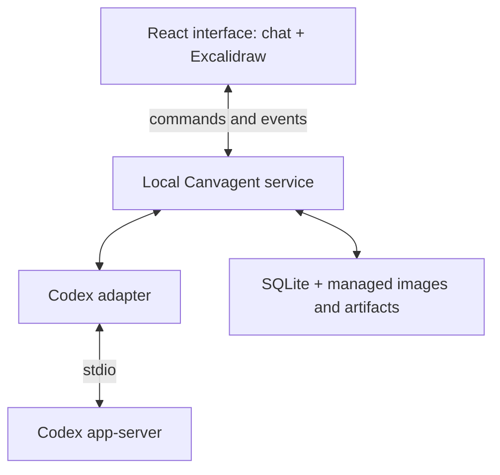

# canvagent

Canvagent is an agent harness with a persistent canvas shared by the user and agent. It combines ordinary chat, workspace tools, execution controls, session history, and progress with a visual workspace both participants can inspect and edit.

The agent knows the canvas exists throughout the session. It can understand sketches and screenshots, annotate ideas, explain work, and place artifacts on the same board you use.

**Status:** planning. No application code is implemented yet.

## Plan

- [Phases of work](docs/roadmap.md): dependencies, deliverables, exit gates, and the v1 release boundary.
- [Architecture](docs/architecture.md): components, state ownership, runtime integration, and recovery.
- [Data models and contracts](docs/contracts.md): entities, board operations, canvas context, agent tools, runtime adapter, and UI transport.
- [Adversarial review](docs/adversarial-review.md): material findings, minimal fixes, and what remains to prove.

## Product experience

Open a project, start or resume a normal agent conversation, and use chat and the canvas together. Sketch a settings screen, select it, and ask the agent to build it. The agent inspects the sketch, performs ordinary project work, and places an annotated screenshot or artifact link near the drawing. Edit the drawing and continue the conversation.

Canvas context is supplied automatically. During an active turn, committed human edits produce batched resource-change notices when the runtime supports them; explicit messages give instructions. Idle drawing stays idle. Canvas use is optional for any particular task.

## Architecture at a glance

Canvagent owns the UI, session coordination, canvas awareness, saved board, and artifact references. Codex owns the existing agent execution loop, built-in tools, sandbox, and provider conversation history.

The local service is authoritative for board state. Both the browser and agent submit validated, atomic edits with per-object revision checks. Agent changes are attributed and support safe undo. Excalidraw native scene data remains the saved visual representation.

The proposed stack is TypeScript, React, Excalidraw, a local Node.js service, SQLite, managed file storage, and a pinned Codex app-server integration. First prove chat → canvas read → editable annotation, then save/reopen that working application. Initially capture images through the connected browser. Add lifecycle, live notices, artifacts, and recovery incrementally.

## Delivery phases

| Phase | Outcome |
| --- | --- |
| 0 | Prove chat, visual inspection, and editable agent drawing in one small application. |
| 1 | Save and reopen that working loop with basic edit correctness. |
| 2 | Build ordinary chat, tools, approvals, cancellation, and resume. |
| 3 | Complete automatic awareness, mid-run notices, and editing ergonomics. |
| 4 | Complete visual feedback and artifact workflows. |
| 5 | Verify recovery and ship the local v1. |

V1 supports one project board, one editing browser, and one active agent turn at a time. Saved sessions can share the project board. Persistence, source images, artifacts, conflict handling, and safe undo are required for the first release.

MCP access for external clients, other providers, portable export, human multiplayer, and hosted deployment follow separately. Excalidraw is [MIT licensed](https://github.com/excalidraw/excalidraw/blob/master/LICENSE); agent usage follows the selected provider's authentication and billing.
