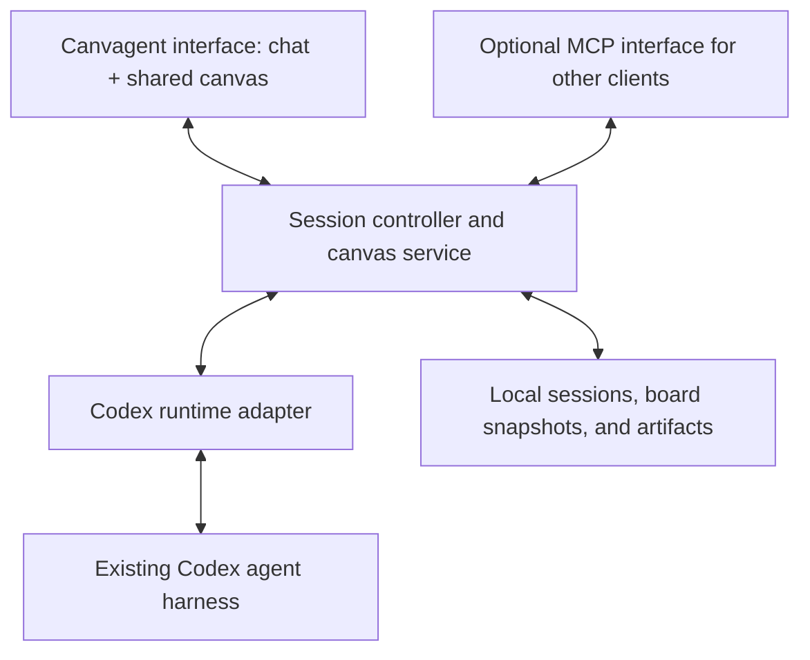

# canvagent

Canvagent is an agent harness with a persistent canvas shared by the user and agent. It provides the usual conversation, tools, workspace access, session history, progress, and execution controls, alongside a visual workspace both participants can read and edit.

The agent knows the canvas exists throughout the session and can use it to understand visual instructions, ask questions, explain ideas, annotate work, and present artifacts.

Status: planning. This repository currently contains the proposed product and implementation plan.

## Product experience

A user opens a project and starts or resumes an agent conversation. Chat and the shared canvas are available together. The user can type a normal request, sketch an idea, paste a screenshot, or point the agent to selected canvas objects.

The agent continues ordinary work through its existing runtime and tools. It can also inspect the board, add diagrams or annotations, and attach outputs to relevant objects. The user can edit those outputs and continue the conversation.

Example: the user sketches a settings screen and asks the agent to build it. The agent inspects the sketch, asks a question beside an ambiguous control, implements the screen in the project, and places a screenshot and preview link near the original drawing. The conversation retains the implementation details and execution history.

Canvas use is optional for any individual task. The agent can work entirely through chat and tools when that suits the request.

## First version

- One user and one active agent session in a local project.
- Normal chat with streamed responses, visible tool activity, cancellation, and the runtime's permission controls.
- Session persistence and resume.
- An embedded Excalidraw board supporting drawing, text, connectors, and pasted images.
- Persistent canvas identity and content associated with the project and available to its sessions.
- Canvas awareness included in the agent's session context.
- Agent tools to inspect, capture, annotate, and update the board.
- Local artifact references and linked image previews on the board.
- Attribution, undo, and conflict handling for agent edits.

Human multiplayer, simultaneous agents, hosted accounts, and rich interactive artifact embeds can follow after this loop works.

## Agent awareness

At session start and on each user turn, provide the canvas identifier, revision, a compact overview, current selection, and a summary of relevant changes since the agent last observed it. Provide a short instruction explaining when and how the agent can use the canvas.

The agent can request structured objects and regional screenshots for detail. Structured data captures text, object identity, and connections; screenshots capture drawings and visual arrangement.

Edits made while the agent is working update the bridge's board state and pending change summary. A subsequent read returns current state. A user action such as "Send update to agent" explicitly delivers new instructions during a run when the adapter supports steering; otherwise it queues them for the next turn. Pen strokes alone do not repeatedly start model calls or become new instructions.

An agent can proactively inspect and annotate the board when useful. The user does not need to explicitly attach the canvas on every message. Freehand marks and board content remain context until the user asks the agent to act on them.

## Architecture

The session controller routes messages, agent events, approval requests, and canvas operations. The canvas service maintains the latest accepted board state and serves both browser actions and agent tools.

Reuse the underlying agent runtime for its execution loop, tools, context management, and sandbox behavior. The proposed first adapter uses Codex app-server. Keep its protocol inside the adapter and pin the supported CLI version.

MCP can expose the same canvas service to compatible external agents. It is an interoperability option; the first usable Canvagent version includes its own ordinary chat and session experience.

## Canvas tools

The initial tool contract can remain small:

| Tool | Purpose |
| --- | --- |
| `read_canvas` | Read an overview, selection, objects, connections, or changes. |
| `capture_region` | Render a selected region for visual understanding. |
| `apply_canvas_ops` | Add or update editable shapes, text, connectors, and annotations. |
| `attach_artifact` | Place an image preview or reference to a generated output. |

Mutations use stable object IDs and expected object revisions. Conflicting changes return enough information for the agent to read current state and revise its operation. Do not replace the entire board from an old snapshot.

Each logical agent edit is grouped for undo and records its author and originating session or run. Unrelated user edits remain intact.

## Proposed technology choices

- TypeScript for the interface, bridge, and first runtime adapter.
- React and the embedded Excalidraw package for the visual workspace.
- A local Node.js service for sessions, canvas tools, and the runtime connection.
- Codex app-server over local stdio for the initial agent integration.
- Local persistent storage for board snapshots, session associations, and artifact files; choose the simplest storage format during the first implementation spike.
- Additional provider adapters after the Codex interaction works end to end.

Excalidraw is MIT licensed. Its embedded package provides editor APIs but does not include the hosted application's collaboration system; Canvagent supplies the user-agent state connection. Local human-agent sharing is sufficient for the first version.

## Delivery milestones

1. **Harness foundation:** open a local project, start a Codex conversation, stream responses and tool events, handle approvals, cancel work, and resume a session.
2. **Shared canvas:** embed and persist the board, supply canvas context to the session, and let the agent read and write through validated tools.
3. **Complete interaction:** use a sketch or screenshot to guide actual project work, return an annotated explanation and artifact to the board, and continue from a user correction.
4. **Reliability and portability:** verify conflict handling, undo, reconnection, image persistence, and resume; then expose the canvas through MCP and add another provider adapter.

The first usable release combines milestones 1 through 3.

## Acceptance criteria

- A user can carry out a normal agent task through chat, tools, and permission controls.
- The agent can identify and inspect the shared canvas without the user reattaching it.
- A selected sketch or screenshot can guide a real task in the project.
- The agent can add editable annotations and a resulting artifact to that same board.
- A user correction reaches the agent on a subsequent turn or through explicit steering.
- User edits made during an agent run are preserved when the agent writes its response.
- Restarting the app restores the board, its images, artifact references, and session association.

## References

- [Excalidraw embedding and collaboration FAQ](https://docs.excalidraw.com/docs/@excalidraw/excalidraw/faq)
- [Excalidraw editor API](https://docs.excalidraw.com/docs/@excalidraw/excalidraw/api/props/excalidraw-api)
- [Excalidraw license](https://github.com/excalidraw/excalidraw/blob/master/LICENSE)
- [Codex app-server](https://developers.openai.com/codex/app-server/)
- [Codex MCP support](https://developers.openai.com/codex/mcp/)
