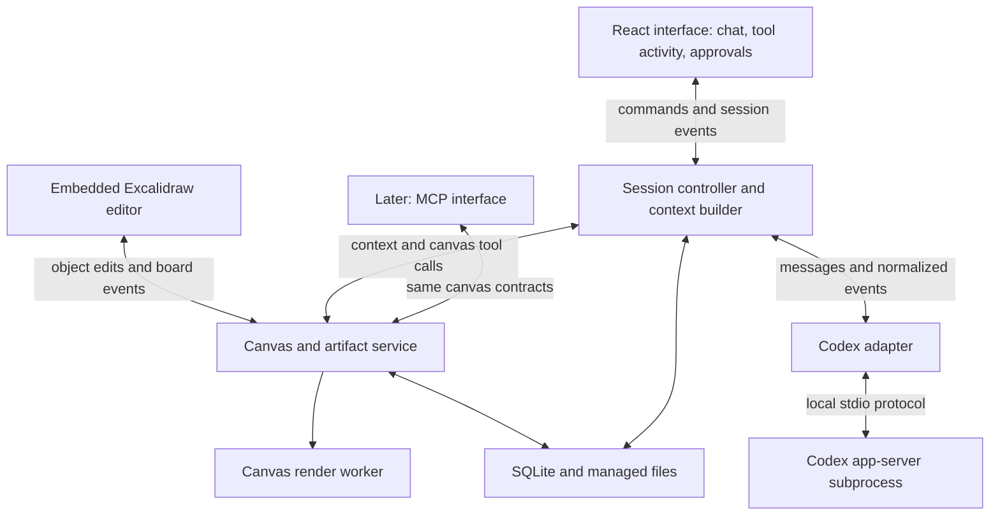

# Architecture

Canvagent is a local agent harness with chat and a persistent canvas shared by the user and agent. The first implementation reuses Codex's runtime and embeds Excalidraw. The local Canvagent service coordinates both surfaces and owns the saved board.

This is the proposed v1 design. The [roadmap](roadmap.md) identifies the feasibility checks before implementation; the [contracts](contracts.md) define the important data and boundaries.

## Scope and deployment

Run one local Node.js service and open its React interface in a browser. The service starts a pinned Codex app-server subprocess over stdio. Use TypeScript across Canvagent.

V1 supports one open project, one board per project, one active agent turn, and one editing browser connection. Projects can have multiple saved sessions; each session is associated with that project's board. Reopening an old session shows the current board and its intervening changes. Historical board revisions are read-only context, rather than an automatic rollback.

Use SQLite for application metadata, board snapshots, operation receipts, and durable event records, plus a local managed directory for image and artifact bytes. Provider conversation history remains owned by Codex; Canvagent stores the provider thread reference and the UI records it needs. Storage lives in the user's application data directory, separate from project source files.

No hosted backend or human multiplayer is required for v1. The local service binds to loopback and authenticates its browser connection; provider credentials stay in the runtime's supported authentication system.

## Components

| Component | Owns |
| --- | --- |
| React interface | Conversation presentation, input, tool activity, approval prompts, connection and save state. |
| Excalidraw adapter | Native editor integration, selection, optimistic drawing, conversion to object patches, and rendering accepted board changes. |
| Session controller | Project/session association, turn lifecycle, explicit user instructions, event routing, and pending approval correlation. |
| Context builder | Bounded board overview, changed-object summaries, selection references, and delivery receipts. |
| Canvas service | Canonical board state, revision checks, atomic mutations, undo records, image references, and artifact attachment. |
| Render worker | Regional images of a specific committed board revision, including its managed image files and fonts. |
| Codex adapter | Translation between Canvagent contracts and a pinned app-server version, tool registration, streaming, cancel, resume, and approvals. |
| Codex runtime | Agent loop, model interaction, built-in file and command tools, execution policies, sandbox, and provider conversation history. |

These are modules within one application. Only the Codex subprocess and render worker need process isolation; there is no microservice requirement.

## State ownership

The backend is authoritative for committed board state. The browser has an optimistic working view and a queue of unsaved changes. Both human edits and agent edits pass through the same canvas service.

Persist the native Excalidraw scene payload and managed image references. Add Canvagent-owned revisions and attribution alongside native elements. Do not build a second, independently editable shape database. The agent receives a simplified read projection; its write tools expose a limited set of validated shape operations.

Selection, hover, viewport, and in-progress pointer motion are client interaction state. They do not advance the saved board revision. A user send first flushes pending drawing changes, then submits a request referring to the acknowledged revision and selection. If saving fails, show the failure and retain the pending edits.

The service serializes committed mutations. Each successful batch increments the board revision once and commits the snapshot, history, idempotency receipt, and board event in one SQLite transaction. Updates and deletes check the expected revision of every affected object. Changes elsewhere on the board do not cause a false conflict.

## User request and agent response

1. The user sends a message, optionally with selected objects or a region. The UI flushes and acknowledges pending board edits first.
2. The controller records the user message, creates a turn, and builds canvas context from a committed revision.
3. The adapter submits the instruction and clearly separated canvas context to Codex. Context identifies the board and available canvas tools even when no objects were explicitly selected.
4. Codex performs normal work. A canvas tool call returns through the adapter to the same canvas service the browser uses.
5. A validated agent edit commits atomically, records attribution, and broadcasts the new board revision. The editor reconciles that update without echoing it back as a human edit.
6. Generated files are registered as durable artifacts before their previews or references are attached to the board.
7. Chat and tool events continue normally; the runtime completes, fails, or interrupts the turn.

Canvas tool failures return structured results to the agent so it can inspect current state and recover. A failed annotation does not erase the conversation or falsely mark ordinary project work as complete.

## Canvas awareness

Session instructions describe the canvas and when to use it. Every user turn includes a compact current overview, the context revision, selection, and changes since the session's last delivered canvas context. Large object lists and images are fetched on demand through tools.

A delivery receipt tracks what context was submitted to the provider. It does not claim the model understood or fully inspected the whole board. A regional tool read also records its scope and revision; it does not advance a global observation cursor past unseen changes.

Drawing while a turn runs updates the shared resource and pending change summary. The agent's next canvas read sees current committed state. An explicit "Send update to agent" action supplies a new instruction through steering when supported, or visibly queues it for the next turn. A drawing change alone does not start a model request.

Board text and imported images are supplied as user-authored context, separate from application instructions. The agent may inspect and annotate proactively as part of a requested task.

## Rendering and artifacts

Rendering must not depend on the editing browser remaining open. The proposed implementation uses the pinned Excalidraw export code in a local headless browser worker. Phase 0 must prove that text, fonts, images, and region bounds render correctly from a saved snapshot.

Every capture names the board revision actually rendered. A slow render never silently substitutes a newer board. If that revision is no longer available, return an explicit error.

An artifact is an immutable managed file with a stable ID, media type, byte size, and content hash. Copy useful outputs from the project into managed storage before attaching them. A board attachment points to the artifact ID, not a temporary path or expiring preview URL. Pasted source images use the same managed-byte storage, with a distinct asset role.

## Runtime integration

Use a small provider adapter around Codex app-server. Phase 0 verifies the exact supported protocol for session creation, tool registration, image inputs/results, streamed events, approvals, cancellation, and resume. Record the working CLI version and authentication path.

Prefer native client-defined tools when the pinned runtime supports the required contract. If that path cannot serve these tools reliably, a local MCP transport may connect the same handlers to Codex. Tool schemas and board semantics stay the same in either case.

The adapter declares capabilities such as steering and image tool results. Unsupported capabilities have explicit behavior. Canvagent forwards approval decisions against the exact live runtime request; board clicks never implicitly grant command execution permission.

After an uncertain submission or a lost runtime connection, reconcile the existing turn before starting another. Reconnect does not blindly resend instructions or approvals. If the runtime has exited, keep the transcript and board, mark the run interrupted or unknown as appropriate, and offer resume.

## Persistence and recovery

Saved means the backend acknowledged a durable transaction. The UI shows saving, saved, disconnected, and conflicted states. On reconnect, fetch a current board snapshot and replay durable session events after the client's cursor. Replay events update presentation and never repeat their side effects.

Store assets completely before committing scene references to them. A crash can leave an unreferenced file, which can be cleaned up later; it must not leave a successfully acknowledged board pointing to bytes that were never written.

Undo is a new revision-checked mutation derived from the original batch's before-images. It cannot restore an entire old board over later edits. If affected objects changed afterward, report a conflict and let the user inspect it.

## Later extensions

Expose the existing canvas service over MCP for external clients. Add another agent adapter against the same session and tool contracts. Human multiplayer would require a separate review of editing leases, presence, and merge behavior; it is not assumed to work through v1's single-editor optimistic patches.

See [data models and contracts](contracts.md) and [phases of work](roadmap.md) for implementation details and completion criteria.

## Primary references

- [Codex app-server protocol](https://developers.openai.com/codex/app-server/)
- [Codex MCP configuration](https://developers.openai.com/codex/mcp/)
- [Excalidraw editor API](https://docs.excalidraw.com/docs/@excalidraw/excalidraw/api/props/excalidraw-api)
- [Excalidraw export utilities](https://docs.excalidraw.com/docs/@excalidraw/excalidraw/api/utils/export)
